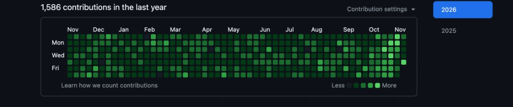

# Rupraj Datta

  <strong>Software &amp; Systems Engineer</strong> • <strong>Application Security &amp; Distributed Infrastructure</strong> 
  <em>B.Tech in Computer Science &amp; Engineering — Bennett University (Noida, India)</em>

  

> **🎯 Executive Objective**: Actively seeking **Software Engineering Internships** and **Early Career Systems / Backend / AppSec Roles** (2026/2027). Focused on high-concurrency architectures, network packet inspection (DPI), OWASP API security hardening, and resilient distributed protocols. Open to on-site, hybrid, or remote opportunities globally.

---

## 🌐 Open-Source Upstream Contributions

<!-- OSS-PRS:START -->

| Repository | Pull Request | Stack | Status | Date |
| :--- | :--- | :---: | :---: | :---: |
| 🐍 **[calibrain/shelfmark](https://github.com/calibrain/shelfmark)** | **[Spool large debrid downloads to disk](https://github.com/calibrain/shelfmark/pull/1632)** | `🐍 Python` | 🟣 **Merged** | Nov 2026 |
| 🐍 **[AaronCreor/PyFuncAI](https://github.com/AaronCreor/PyFuncAI)** | **[Add JSON metadata output to cache list](https://github.com/AaronCreor/PyFuncAI/pull/6)** | `🐍 Python` | 🟣 **Merged** | Nov 2026 |
| 🐍 **[nikhilrai-tech/Nigrani](https://github.com/nikhilrai-tech/Nigrani)** | **[Add ratio unit for fractional metrics](https://github.com/nikhilrai-tech/Nigrani/pull/45)** | `🐍 Python` | 🟣 **Merged** | Nov 2026 |
| **[firstcontributions/first-contributions](https://github.com/firstcontributions/first-contributions)** | [Add Rupraj Datta to Contributors](https://github.com/firstcontributions/first-contributions/pull/127760) | `Multi-Stack` | 🟣 **Merged** | Nov 2026 |
| **[OWASP/CheatSheetSeries](https://github.com/OWASP/CheatSheetSeries)** | [docs(xss): normalize quotes and apostrophe in WAF bypass strings (#2792)](https://github.com/OWASP/CheatSheetSeries/pull/2918) | `JavaScript` | 🟣 **Merged** | Nov 2026 |

<!-- OSS-PRS:END -->

---

## 🚀 Flagship Systems & Cybersecurity Repositories

| Repository | Domain & Architecture | Core Highlights & Tech Stack | Validation |
| :--- | :--- | :--- | :---: |
| **[🛡️ Backend Security Sentinel](https://github.com/29rdx/backend-security-sentinel)** | **OWASP API Vulnerability Scanner** | Automated auditor targeting OWASP API Top 10 risks: BOLA authorization bypass, SSRF cloud metadata filtering (`169.254.169.254`), JWT key confusion (`alg: none`), and Shannon entropy secret extraction.  `Python` `OWASP` `DevSecOps` `FastAPI` |  |
| **[🛡️ Sentinel DPI Engine](https://github.com/29rdx/sentinel-dpi-engine)** | **High-Throughput Deep Packet Inspection** | C++17 wire-rate packet dissection engine: 802.1Q VLAN tag parsing, IPv6 extension headers, lock-free ring buffers, JA3 TLS Client Hello fingerprinter, and DNS entropy covert-channel detection.  `C++17` `Network Security` `DPI` `PCAP` |  |
| **[🛡️ CVE Analysis Vault](https://github.com/29rdx/cve-analysis-vault)** | **Vulnerability Research & Test Harnesses** | In-depth root-cause autopsies and safe test harnesses: CVE-2024-3094 (XZ IFUNC backdoor ELF scanner & YARA signatures), CVE-2023-4863 (libwebp Huffman heap overflow), and CVE-2023-44487 (HTTP/2 Rapid Reset).  `Python` `C++17` `AppSec` `Exploit Research` |  |
| **[🛡️ Aegis Mesh Pay](https://github.com/29rdx/aegis-mesh-pay)** | **Zero-Connectivity Offline Payments** | Resilient offline payment gateway: Offline UPI, RSA-2048 + AES-GCM signed transaction vouchers, BLE binary mesh transport, SHA-256 Merkle tree ledger, and Bloom filter double-spend prevention.  `Java 17` `Spring Boot` `Cryptography` `Zero-Trust` |  |
| **[🛰️ Nakshatra-X 3D Platform](https://github.com/29rdx/newNakshatra-x)** | **Geospatial Intelligence & Spectral Telemetry** | Interactive orbital 3D telemetry visualization, live mission control dashboard, and automated spectral band-ratio processing pipelines built for MOIL Limited (Smart India Hackathon).  `JavaScript` `HTML5` `CSS3` `Three.js` `REST APIs` |  |

---

## 🏆 Engineering Leadership

### **Team Head & Lead Architect — Team Nakshatra-X**
*Smart India Hackathon (SIH 2026) • Ministry of Steel & MOIL Limited*  
`JavaScript` `HTML5` `CSS3` `Three.js` `REST APIs` `STAC Sentinel-2`

- **SIH Qualifier**: Successfully led Team Nakshatra-X through competitive university selection rounds for the Smart India Hackathon.
- **Client & Problem**: Architected an orbital geospatial intelligence and sub-surface manganese prospectivity mapping platform for MOIL Limited.
- **Architecture**: Directed full-stack development, implementing interactive 3D Earth telemetry (`Three.js`), live mission control dashboards, and automated ESA Sentinel-2 spectral band-ratio processing pipelines.
- **Repository**: [github.com/29rdx/newNakshatra-x](https://github.com/29rdx/newNakshatra-x)

---

## 🛠️ Technical Competencies

- **Languages:** Python, Java 17, C++17/20, HTML5, CSS3, SQL, Bash
- **Systems & Architecture:** Deep Packet Inspection (DPI), Lock-Free Ring Buffers, High-Concurrency APIs, Streaming Telemetry, Microservices
- **Cybersecurity & Cryptography:** OWASP API Top 10, Zero-Trust Architecture, RSA-2048 / AES-GCM, Merkle Proofs, YARA Rule Authoring, Vulnerability Analysis
- **Infrastructure & Tools:** Linux / POSIX APIs, Git, GitHub Actions CI/CD, Docker, MySQL, SQLite

---

## 📬 Contact & Connect

- 📧 **Direct Email:** [dattarupraj@gmail.com](mailto:dattarupraj@gmail.com)
- 💼 **LinkedIn:** [linkedin.com/in/dattarupraj](https://www.linkedin.com/in/dattarupraj)
- 💻 **GitHub:** [github.com/29rdx](https://github.com/29rdx?tab=repositories)
- 📍 **Location:** Noida, Uttar Pradesh, India
